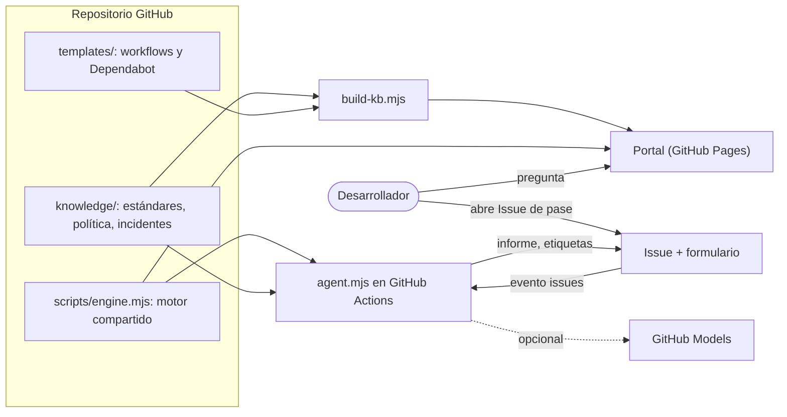
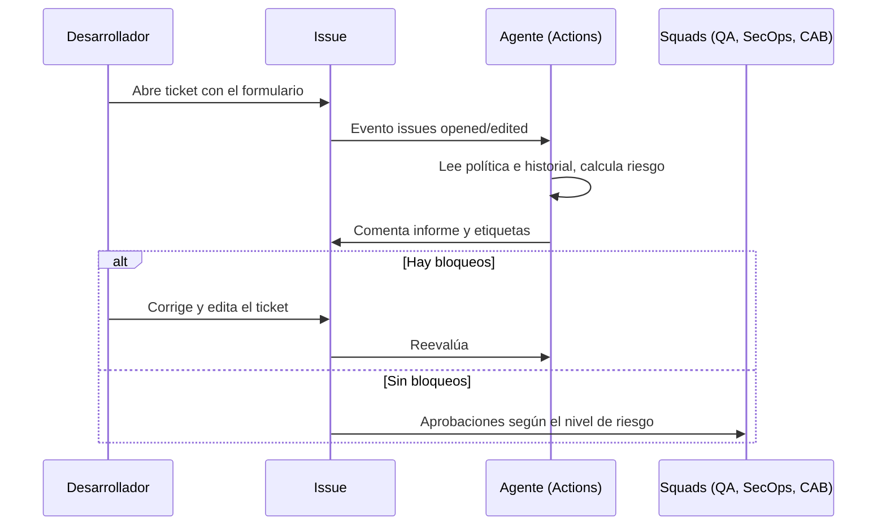

# Arquitectura

## Vista general

## Flujo del pase

## Piezas
| Pieza | Archivo | Función |
|---|---|---|
| Estándares | `knowledge/0*.md` | Fuente única de verdad, versionada y revisable por pull request |
| Política de riesgo | `knowledge/policy.json` | Pesos, bloqueos y aprobaciones por nivel |
| Historial | `knowledge/incidents.json` | Incidentes que alimentan la prevención |
| Motor | `scripts/engine.mjs` | Búsqueda, lectura del formulario, riesgo e informe. Mismo código en navegador y en Actions |
| Agente | `scripts/agent.mjs` + `.github/workflows/agente-pase.yml` | Evalúa y publica en el Issue |
| Portal | `docs/` | Chat, validador y plantillas |
| Plantillas | `templates/` | CI de seguridad, release, Dependabot |
| Copilot | `.github/copilot-instructions.md`, `.github/agents/` | Los agentes de Copilot de la entidad usan la misma base |

## Cálculo del riesgo (transparente)
Puntaje de 0 a 100 = criticidad + tamaño + rollback + día de riesgo + controles faltantes + incidentes recientes del servicio. Todos los pesos están en `policy.json`.
- Bajo hasta 29, Medio hasta 54, Alto hasta 74, Crítico por encima.
- **Bloquea** sin importar el puntaje: falta de QA, SAST, SCA, secretos, aprobación del squad o rollback.
- Cada nivel define las aprobaciones requeridas.

## Qué es IA y qué es regla
- Reglas deterministas: puntaje, bloqueos y aprobaciones. Son auditables y reproducibles.
- IA generativa (opcional): solo redacta los siguientes pasos con la política recuperada como contexto. Si falla, el informe sale igual.
